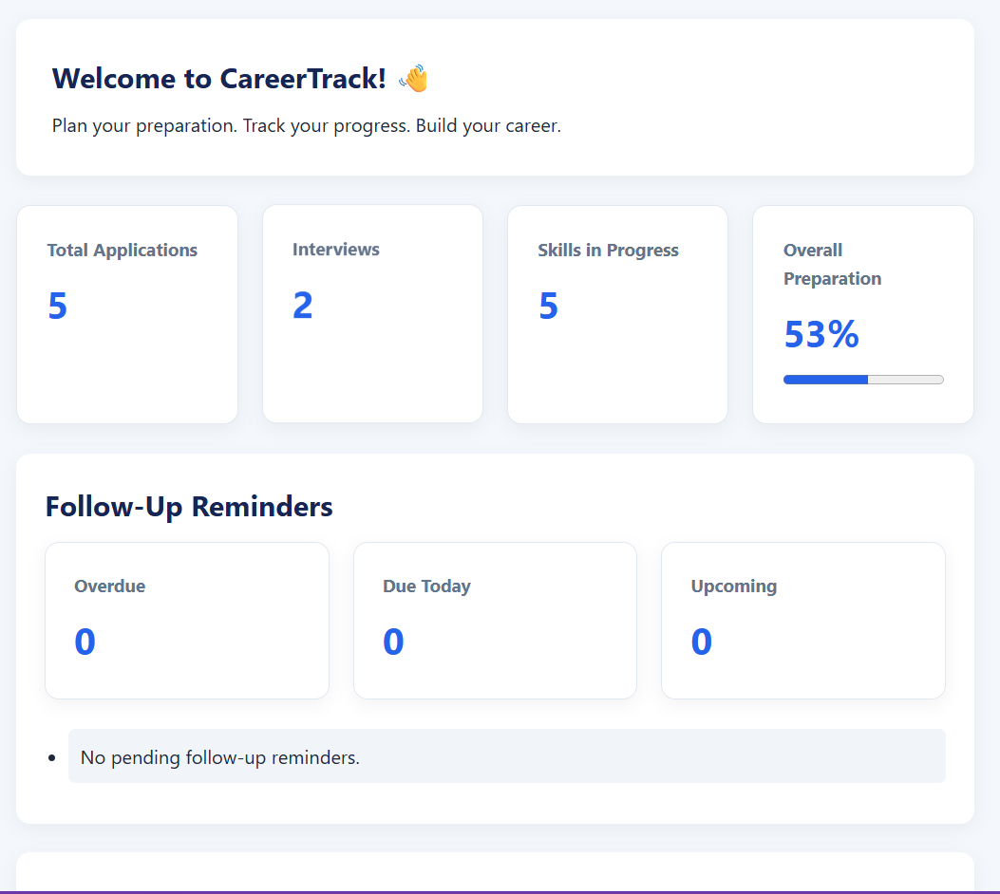

# CareerTrack — Smart Placement Preparation & Tracking System

CareerTrack is a responsive web application that helps students manage job applications, organize placement activities, and monitor their preparation progress in one place.

## 📸 Project Screenshot

## 🚀 Features

- 📊 **Dashboard:** View job application statistics.
- 📝 **Application Tracker:** Add, edit, and delete job application records.
- 📅 **Date Tracking:** Store application dates and follow-up dates.
- 🔔 **Follow-Up Reminders:** Identify overdue, due-today, and upcoming follow-ups.
- ✅ **Completion Tracking:** Mark follow-up reminders as completed.
- 🔍 **Search and Filter:** Find applications and filter them by status.
- 🎯 **Preparation Progress:** Track progress across CSE subjects.
- 💾 **Local Storage:** Keep application data saved in the browser.
- 📱 **Responsive Design:** Use the dashboard on desktop and mobile screens.

## 🛠️ Technologies Used

- HTML5
- CSS3
- JavaScript
- Browser Local Storage
- Git and GitHub

## 📂 Project Structure

- `index.html` — Application structure
- `style.css` — Styling and responsive layout
- `script.js` — Application logic and interactions
- `README.md` — Project documentation

## ▶️ How to Run Locally

1. Clone or download this repository.
2. Open the project folder in Visual Studio Code.
3. Open `index.html` in your browser.
4. Alternatively, run the page using the Live Server extension in VS Code.

## 💡 Project Objective

CareerTrack was created to practice frontend web development by building a practical tool for placement preparation and job application management.

## 🔮 Future Improvements

- More advanced dashboard analytics
- Improved application tracking features
- Additional placement preparation tools
- Backend integration and database support

## 👩‍💻 Developer

Developed as a learning project to practice HTML, CSS, JavaScript, and Git/GitHub workflows.
